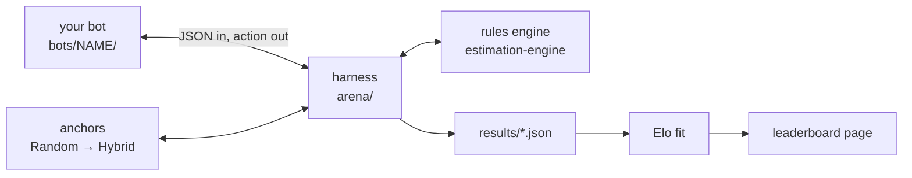
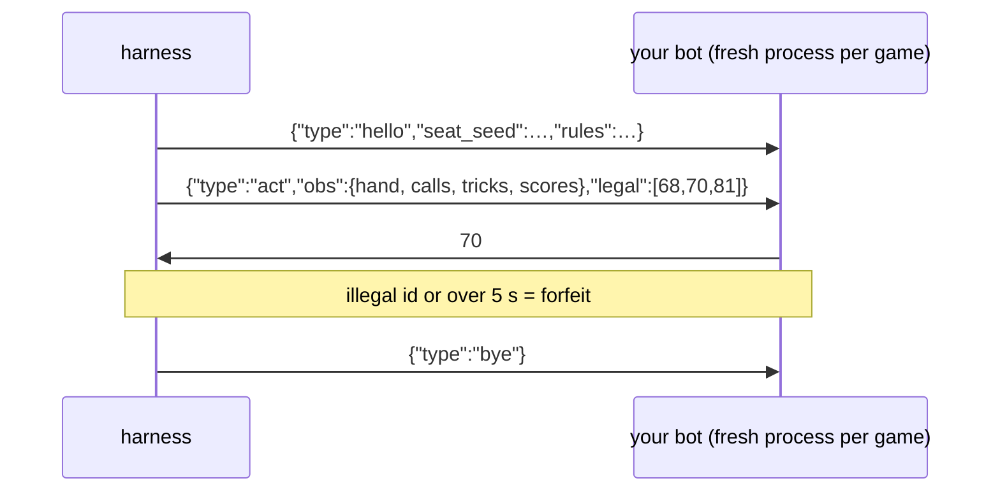
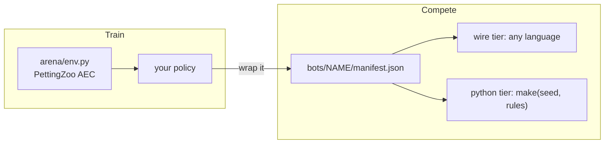
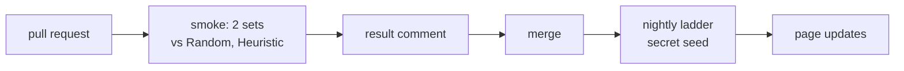

# Estimation Arena

Write a bot for **Estimation**, the 4-player trick-taking card game. Get an Elo.

**Leaderboard:** https://essamgouda97.github.io/estimation-arena/



## One decision



Action ids: `0-1` dash, `2-51` bids, `52` with, `53` pass, `54-67` estimates, `68-119` cards.

## Two doors



## Quickstart

```bash
uv sync                                   # needs read access to the engine repo
uv run pytest -q
uv run python -m arena.run --bot table-pressure --sets 10 --workers 4
uv run python -m arena.leaderboard && open site/index.html
```

## Submit



Examples: `bots/lowcard-wire` (stdlib, 40 lines), `bots/table-pressure` (rung 1, beats Heuristic).

## Play

```bash
uv sync --group table && uv run python -m arena.serve    # http://127.0.0.1:8790/
```

Any mix of people and bots per table; agents join a person's seat over the same WebSocket.
Protocol: [docs/table.md](docs/table.md).

## Fair by construction

| Rule | Why |
|---|---|
| Duplicate sets: every deal played 4 times, seats rotated | Deal luck cancels |
| Fresh process per game, no seed sent | No peeking across rotations |
| Elo from who finished ahead, not raw score | Stacked doubles make scores explode |
| Leaderboard seed is a secret | No tuning to the test deals |

## Where it runs

| Piece | Where | Cost |
|---|---|---|
| Smoke + nightly ladder, CPU anchors | GitHub Actions | free (public repo) |
| RL v2 + Hybrid anchors, training | home server, `runs/` unzipped | free |
| Page | GitHub Pages | free |
| Live table | home server, owner-only | free |
| Promo video ([video/](video/)) | home server render | free |

Secrets: `ENGINE_TOKEN` (read access to the engine repo), `LADDER_SEED`.
Training design: [docs/training-design.md](docs/training-design.md).
GPU rules for self-play at scale: [docs/jax-rules.md](docs/jax-rules.md).

## Using a coding agent?

Paste this:

```text
Read AGENTS.md in this repo and follow it. Set up the environment, run the tests, then
build a bot in bots/<my-name>/ that beats the current top submission against Heuristic.
Tune with arena.sweep on the tuning seed, confirm on a fresh seed with 1,000 sets,
rate with arena.run, and open a pull request with the numbers.
```
