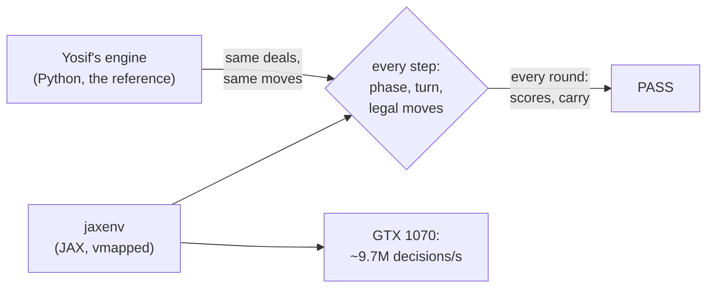

# Estimation rules in JAX

The bitter-lesson track starts here: the whole game on the GPU, so self-play can scale with
compute instead of hand-made features, rules and search.



| Piece | File | Mirrors |
|---|---|---|
| One round: state, legal moves, step, scoring | `jaxenv/rules.py` | `estimation.engine.round`, `scoring` |
| A full game: carry, fixed trumps, replays | `jaxenv/game.py` | `estimation.engine.bola` |
| Move-by-move comparison | `jaxenv/check.py`, `tests/test_jaxenv.py` | |
| Throughput | `jaxenv/bench.py` | |

```bash
UV_PROJECT_ENVIRONMENT=.venv-jax uv sync --group jax     # on the home server
.venv-jax/bin/python -m jaxenv.check --rounds 100000 --games 1000
.venv-jax/bin/python -m jaxenv.bench
```

## Verified identical (3 November 2026)

The check plays the same deals in both implementations, choosing each move from the engine's
legal list. It requires the same phase, the same player to act and the same full set of legal
moves at every step. It also requires the same scores, next carry, skip flag and trump change
for every round, and the same final scores for every game.

| Run | Steps compared | Result |
|---|---|---|
| 100,000 rounds: open and fixed-trump, random carries and scores | ~5.8 M | identical |
| 1,000 full games through `Bola` | ~1.8 M | identical |
| 10 scripted auctions from the engine's AUC-3 to AUC-6 and L1 to L10 tests, × 20 play-outs | ~12,700 | identical |

Moves mix uniform random play (reaches rare rules), an auction-heavy policy (Dash Calls,
Withs, stays) and HeuristicBot play (realistic games). How often the rare rules fired in the
100,000-round run:

| Rule | Times |
|---|---|
| super call (FIX-4) | 28,205 |
| answering a raise (AUC-3) | 11,746 |
| lone bidder (AUC-5) | 8,332 |
| skipped rounds, incl. 1,915 with four Dash Calls | 7,845 |
| an answer barred by the 13 rule (AUC-6) | 45 |
| exploding-doubles games flagged | 99 of 1,000 |

The top bidder's final keep or raise barred by AUC-6 never occurred, in this run or in
923,000 engine-only random auctions. In the engine's own tests every such case uses
non-default rule switches.

## Limits

- **Default rules only** (`RulesConfig()`); the switches are constants in `rules.py`.
- **int32 scores.** The engine's scores are unbounded. When all four seats keep failing, the
  doubling carry can leave int32's range. `Game.overflow` flags such a game (carry above
  2^20 or a score past 2^30). The check verifies that the flag rises exactly when the engine's
  numbers leave that range. Training should drop flagged games.
- **Deals** come from JAX keys, not the engine's numpy deal. `advance` takes hands, so tests
  feed the engine's deals.

## Speed (GTX 1070, random legal play)

| | Decisions per second |
|---|---|
| Yosif's engine, one CPU core | ~285,000 |
| our old training loop (features + nets) | ~6,500 |
| **jaxenv, 16,384+ games at once** | **~9.7 M** |

Two GPU lessons: deal from a pre-shuffled pool, because a deal is needed only every ~65 moves
and shuffling is the costly part. And never `sort` tiny rows: XLA's GPU sort of many 3-element
rows was 150x slower past 8,192 games, so `_sort3` ranks by counting instead.

## Next

One network for every decision (Dash, bids, With, estimates, cards) over raw state, PPO
self-play against a pool of past versions, all inside `jax.lax.scan` on the GPU.
