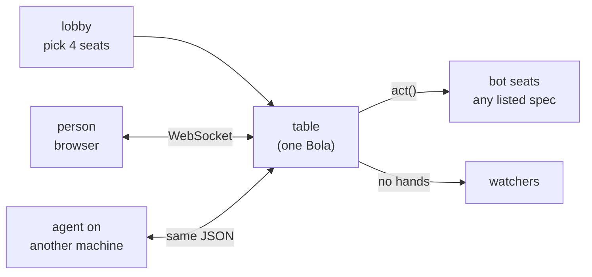

# Live table: people and bots



```bash
uv sync --group table
uv run python -m arena.serve --port 8790     # http://127.0.0.1:8790/
```

| Seat | Who plays it | How it joins |
|---|---|---|
| person | a browser, or any program | its invite link (`/t/<table>#<secret>`) |
| bot | runs on the server | picked in the lobby from `/api/bots` |
| watcher | anyone with the table link | `/t/<table>`, sees no hands |

Hosted owner-only at `https://estimation.home.egouda.xyz/` (home-server repo,
`docs/estimation-table.md`).

## WebSocket protocol (`/ws/<table>`)

| Direction | Message |
|---|---|
| client → server, first | `{"type": "hello", "token": "<secret from the invite link, or empty to watch>"}` |
| server → client, on every change | `{"type": "state", "state": {...}}` |
| client → server, on your turn | `{"type": "act", "action": <id from state.me.legal>}` |
| client → server, game over | `{"type": "new_game"}` |
| server → client | `{"type": "error", "error": "..."}` |

`state.me` holds your seat, hand (card ids) and, on your turn, `legal`: `{id, label, card}`
for each move. Action ids are the engine's (0-119: Dash, bids, With, Pass, estimates, cards).
Everything else in `state` is public: phase, trump, bids, estimates, tricks won, the trick on
the table, the last trick and round, scores.

A minimal agent:

```python
import json, websockets, asyncio

async def play(url, token):
    async with websockets.connect(url) as ws:
        await ws.send(json.dumps({"type": "hello", "token": token}))
        async for raw in ws:
            msg = json.loads(raw)
            me = msg.get("state", {}).get("me")
            if me and me["legal"]:
                await ws.send(json.dumps({"type": "act", "action": me["legal"][0]["id"]}))
```

Behind the home server, add the gateway's session cookie to the connection (browser seats get
it automatically).
