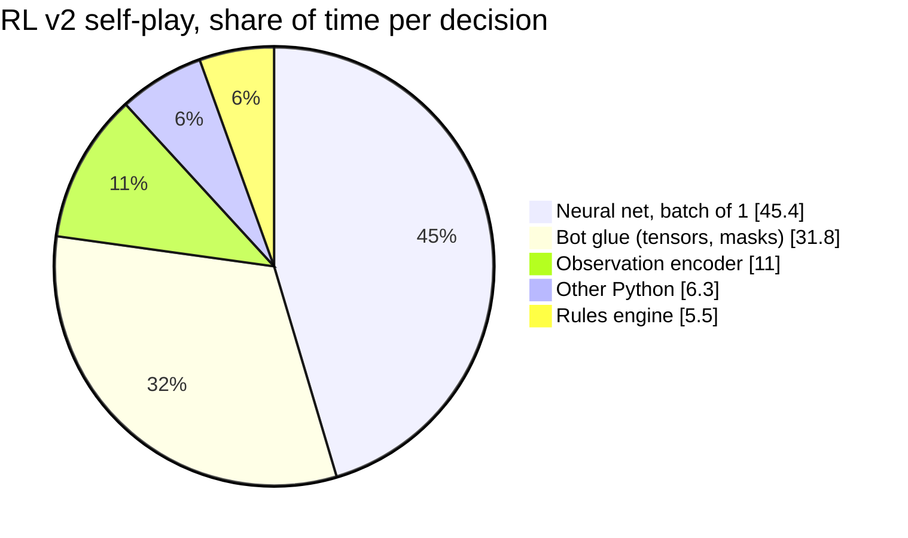
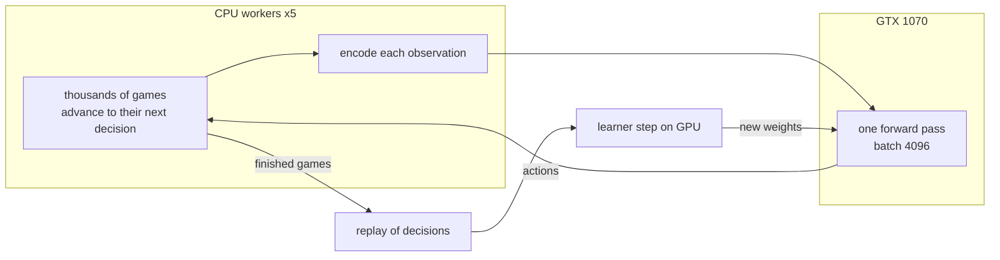
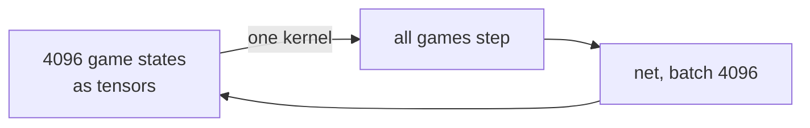

# Training design: make self-play GPU-bound

Measured 2026-11-03 on the home server (i5-8600K, GTX 1070) with
`experiments/profile_selfplay.py`. Decision: **build option 1 for rung 3; spike option 2 later.**

## Where one decision's time goes today

RL v2 playing itself, one core, nets called one position at a time: **645 µs per decision,
1.3 games/s**.

The rules engine is the small part. The GPU sits idle because nothing hands it a batch.

| Cost per position | batch 1 | batch 64 | batch 512 | batch 4096 |
|---|---|---|---|---|
| Net on one CPU core | 120 µs | 16 µs | 14 µs | 14 µs |
| Net on the GTX 1070 | 161 µs | 2.8 µs | 0.46 µs | **0.40 µs** |
| Observation encoder (Python) | 55 µs | | | |
| Rules engine step | 16 µs | | | |

## Option 1: lockstep games, one batched net call (build this)

- Yosif's trainer already plays 8 games in lockstep per worker (`chunk`). Option 1 is that, with
  thousands of games per batch and the nets on the GPU.
- After batching, the net costs ~0. The encoder (55 µs) becomes the limit, then the engine (16 µs).
- Next step inside option 1: vectorize the encoder over the batch with NumPy.

| Stage | Bottleneck | Rough ceiling, 6 cores |
|---|---|---|
| Today, unbatched | net calls | ~8 games/s |
| Yosif's chunk of 8, Mac | net + encoder | 20 games/s (measured) |
| Option 1, GPU batch | encoder | ~60 games/s (estimate) |
| Option 1 + vectorized encoder | rules engine | ~250 games/s (estimate) |

## Option 2: the rules on the GPU (think about, don't build yet)

- Removes the CPU entirely: JAX libraries like PGX reach millions of steps per second this way.
- Cost: rewrite ~1,300 lines of rules (`round.py`, `scoring.py`) as array code, bit-identical
  to the engine. Verify by playing random games in both and comparing every state.
- Middle path worth a spike: ~80% of decisions are card plays (52 of ~65 per round). Port only
  trick play to JAX; keep the auction and estimates in Python.
- Worth it when the nets get big (transformers) or search runs on the GPU. Not before.

## GPU notes for the GTX 1070 (Pascal, sm_61)

| Stack | Works? |
|---|---|
| PyTorch 2.15, the engine's pin | **No**: builds start at sm_75 |
| PyTorch 2.8.0 + CUDA 12.6 wheels | Yes (tested) |
| JAX 0.12 + `jax[cuda12]` | Yes (tested) |

Yosif's trainer picks MPS or CPU (`device = "auto"`); CUDA needs a one-line change there.
