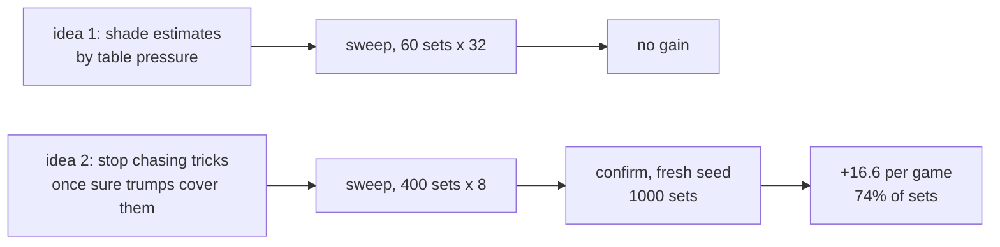

# Rung 1: beat Heuristic with a scripted bot

**Result: passed.** `bots/table-pressure` with `sure=1` beats HeuristicBot on fresh deals.



## Confirmation (seed 2000, 1,000 duplicate sets vs Heuristic)

| Setting | Sets won-drawn-lost | Points per game, 95% CI |
|---|---|---|
| `sure=1` (default) | 742-2-256 | +16.6 [+15.0, +18.2] |
| `sure=1 shift=-0.25 risk=0.5` | 709-2-289 | +17.9 [+16.0, +19.9] |

Intervals overlap, so the default keeps one idea and no tuned numbers.

## Sweeps (tuning seed 1000)

| Sweep | Finding | Data |
|---|---|---|
| pressure 0-1.5, shift -0.5 to +0.25, risk 0.25/0.5; 60 sets | Table pressure never helps; estimating high hurts | `rung1-sweep.json` |
| sure 0/1, shift -0.25/0, risk 0.25/0.5; 400 sets | `sure=1` adds +15 to +18 everywhere; estimate knobs add little | `rung1-sweep2.json` |

## Reproduce

```bash
uv run python -m arena.sweep --bot table-pressure --vs heuristic --sets 60 --seed 1000 --workers 5 \
  --grid pressure=0,0.5,1,1.5 shift=-0.5,-0.25,0,0.25 risk=0.25,0.5
uv run python -m arena.sweep --bot table-pressure --vs heuristic --sets 400 --seed 1000 --workers 5 \
  --grid sure=0,1 shift=-0.25,0 risk=0.25,0.5
uv run python -m arena.sweep --bot table-pressure --vs heuristic --sets 1000 --seed 2000 --workers 5 --grid sure=1
```

## Lesson

The plausible idea lost; the boring card-counting one won. Measure before believing.
