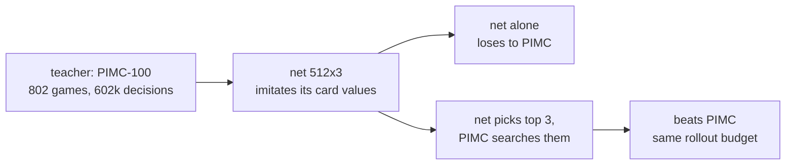

# Rung 2: beat PIMC

**Result: passed at equal compute.** `bots/net-pimc`: a net trained to imitate PIMC-100 picks
the 3 cards worth searching; PIMC searches only those. Confirmed on fresh deals (seed 2000,
300 sets): **161-139, +5.5 points per game [+2.6, +8.4]**.



## Card-play regret vs PIMC-100, points per decision (held-out games)

| Policy | Regret |
|---|---|
| Random legal card | 3.36 |
| HeuristicBot | 2.01 |
| Net alone, 512x3 / 1024x4 / 2048x4 | 1.00 / 0.92 / 0.90 |
| **PIMC-30, the anchor** | **0.54** |
| Best of the 512x3 net's top 2 | 0.35 |
| Best of the 512x3 net's top 3 | 0.16 |

The net alone sits between Heuristic and PIMC. Its top 3 almost always holds the right card.

## Matches vs PIMC (duplicate sets, tuning seed 1000)

| Bot | Rollouts per decision | Sets won-lost | Points per game, 95% CI |
|---|---|---|---|
| Teacher PIMC-100 | ~490 | 21-9 (30 sets) | +10.6 [+0.8, +20.5] |
| Net alone (half the data) | 0 | 5-45 | −29.9 [−37.2, −22.7] |
| net-pimc top 2 × 75 deals | 150 | 85-65 | +4.6 [+0.6, +8.6] |
| **net-pimc top 3 × 50 deals** | **150** | **96-54** | **+8.6 [+4.8, +12.4]** |
| net-pimc top 3 × 100 deals | 300 | 57-43 | +6.0 [+0.8, +11.3] |

The confirmation on a fresh seed is smaller than on the tuning seed (+5.5 vs +8.6), as expected
when the best of several settings is picked on the same deals. Doubling the deals did not help: the search is limited by its Heuristic playouts, not by depth.

## Lessons

- A net can't replace a search; it can tell the search where to look (AlphaZero's policy prior).
- Judge students by regret under the teacher's values, not agreement: half the decisions are
  near-ties (median best-vs-second gap 0.18 points).
- More samples stopped paying. Next lever: better playouts, i.e. expert iteration.

## Reproduce

```bash
uv run python -m train.record --teacher pimc:samples=100 --games 800 --workers 4 --out ~/workspace/estimation-data/rung2/pimc100
.venv-gpu/bin/python -m train.imitate --data ~/workspace/estimation-data/rung2/pimc100 --out net.npz \
  --augment train/suit_tables.npz --hidden 512 --layers 3 --epochs 40 --soft 0.7
uv run python -m arena.sweep --bot net-pimc --vs pimc --sets 150 --seed 1000 --workers 5 --grid top=3 samples=50
PYTHONPATH=. uv run python experiments/teacher_gap.py --games 40 --workers 5
```
