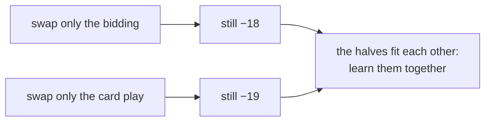
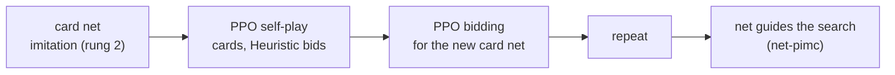

# Rung 3: beat RL v2

## Diagnosis: where is the gap?

Swap halves between our bot and RL v2, play each mix against RL v2 (60 sets, seed 1000).

| Bidding | Card play | vs RL v2, points per game |
|---|---|---|
| Heuristic | net-pimc (ours) | −20.8 [−29.5, −12.1] |
| RL v2 | net-pimc (ours) | −18.0 [−26.0, −10.0] |
| Heuristic | RL v2 | −19.4 [−30.5, −8.2] |

Neither half alone is the gap. RL v2's bids are tuned to what its own card play can make, and
its card play to its bids. Mixing either half with a Heuristic or a search partner loses the fit.

## Plan

