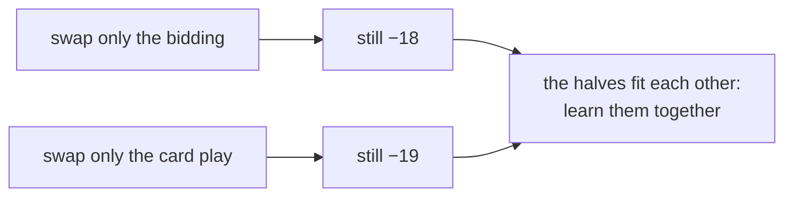
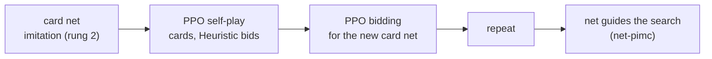

# Rung 3: beat RL v2

**Result: passed.** `bots/rl-pimc`, the net-guided search of rung 2 with a card net trained
further by self-play PPO, beats RL v2 on fresh deals (seed 2000, 300 sets):
**222-78, +21.8 points per game [+18.3, +25.4]**.

## Diagnosis: where is the gap?

Swap halves between our bot and RL v2, play each mix against RL v2 (60 sets, seed 1000).

| Bidding | Card play | vs RL v2, points per game |
|---|---|---|
| Heuristic | net-pimc (ours) | −20.8 [−29.5, −12.1] |
| RL v2 | net-pimc (ours) | −18.0 [−26.0, −10.0] |
| Heuristic | RL v2 | −19.4 [−30.5, −8.2] |

Neither half alone is the gap. RL v2's bids are tuned to what its own card play can make, and
its card play to its bids. Mixing either half with a Heuristic or a search partner loses the fit.

## Plan

## Card play: PPO from the imitation net

| Run | Iterations | Edge over its starting net, points per round |
|---|---|---|
| cards1, from the imitation net | 280 | +4.50 |
| cards2, from cards1 | 370 | +2.18 |

Rounds of 512 games each, half self-play, Heuristic bidding everywhere, one GTX 1070.

## Matches vs RL v2 (tuning seed 1000)

| Bot | Card net | Sets won-lost | Points per game, 95% CI |
|---|---|---|---|
| net-pimc, top 3 | imitation | 17-43 | −20.8 [−29.5, −12.1] |
| rl-cards, net alone | early cards1 | 12-28 | −25.1 [−37.0, −13.3] |
| net-pimc, top 3 | early cards1 | 16-24 | −6.7 [−18.8, +5.3] |
| net-pimc, top 3 | cards1 | 53-47 | +3.8 [−2.5, +10.0] |
| net-pimc, top 2 | cards1 | 60-40 | +10.9 [+3.5, +18.3] |
| **rl-pimc, top 2 (fresh seed 2000)** | **cards2** | **222-78** | **+21.8 [+18.3, +25.4]** |

A sharper net lets the search look at fewer cards: top 2 beats top 3 once the net is RL-trained.

## Bidding by RL: not yet

| Run | Card net | Best edge vs Heuristic bidding, points per round |
|---|---|---|
| bid1, 1,024 rounds per iteration | imitation | −0.56 |
| bid2, 4,096 rounds, lr 1e-4 | cards1 | −1.5 (stopped) |
| bid3, 4,096 rounds, lr 3e-5 | cards2 | −2.5 (stopped) |

PPO never beat HeuristicBot's bidding, so rl-pimc still bids like Heuristic. Likely causes: one
reward per round is noisy, and bids interact with three other bidders. Open problem for rung 4.

## Lessons

- Diagnose before optimizing: the gap was the fit between bidding and card play, not bidding.
- RL on top of imitation is cheap and strong: under an hour of self-play beat hours of search labels.
- Better guide, narrower search: once the net improved, searching 2 cards beat searching 3.
