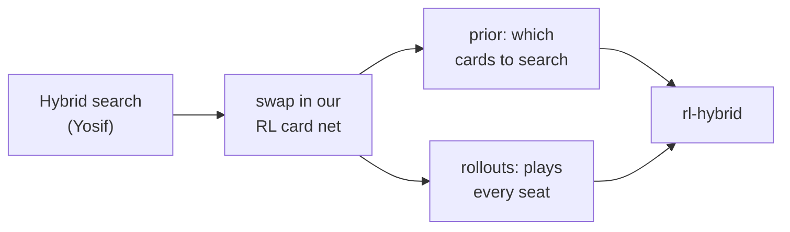
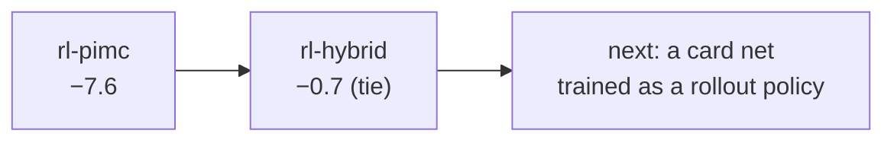

# Rung 4: beat the Hybrid

**Result: not passed, but a tie.** `bots/rl-hybrid`, the Hybrid's own search with our
self-play card net inside, plays the Hybrid even on fresh deals (seed 2000, 200 sets):
**95-105, −0.7 points per game [−5.0, +3.7]**. rl-pimc lost the same match by −7.6 per game.
The Hybrid stays #1.

## Where the gap was

rl-pimc (rung 3) lost to the Hybrid 63-86 over 150 sets. The two differ in three parts:

| Part | rl-pimc | Hybrid |
|---|---|---|
| Bidding | Heuristic | RL v2's bid net |
| Hidden hands it imagines | any that fit the cards seen | weighted by how well they explain everyone's bids |
| Who plays the imagined rounds out | Heuristic, all four seats | RL v2's card net, all four seats |

The Hybrid's rollout code takes any card net, so the cheapest test was to keep its
search and bidding and swap in our self-play card net (bots/rl-cards) as both the prior
and the rollout player.

## Screening vs the Hybrid (tuning seed 1000, 60 sets)

| Bot | Card net | Sets won-lost | Points per game, 95% CI |
|---|---|---|---|
| Hybrid search + our net (prior and rollouts) | rl-cards (rung 3) | 37-23 | +7.9 [+0.7, +15.1] |
| same | cards3: PPO again under RL v2 bids and opponents | 29-31 | +0.3 [−7.8, +8.4] |

The other screening mixes (RL v2 rollouts with our prior, our rollouts with RL v2's prior,
Heuristic bidding) were stopped unfinished: RL v2's rollouts are slow on this CPU, and the
first mix had already found the lever.

## Retraining in the Hybrid's world didn't help

`train/rl_cards.py --bidder rl --opponent rl` fine-tuned the card net with RL v2 bidding at
every seat and RL v2's card net as the opponent. Its edge over RL v2's card play rose from
+0.4 to about +2 points per round, but inside the search it did worse (+0.3 vs +7.9). A
better player alone is not a better rollout policy; the search wants rollouts that
predict how the table actually plays.

## Confirmation (fresh seed 2000)

| Bot | Sets won-lost | Points per game, 95% CI |
|---|---|---|
| rl-pimc (rung 3), 150 sets | 63-86 | −7.6 [−12.9, −2.2] |
| **rl-hybrid, 200 sets** | **95-105** | **−0.7 [−5.0, +3.7]** |

The +7.9 of the 60-set screen did not hold: it was within its own wide interval, and a tie is
inside both. This is the lesson of rung 3 again, at a smaller scale.

## Next levers

- Train the card net for the search, not for play: imitate the Hybrid's searched choices
  (expert iteration), so rollouts predict what the search would do.
- Bidding is still RL v2's. A bid net trained with this card play is the other half of the
  fit found in rung 3.
- More imagined deals per card (the Hybrid uses 16). Cheap to try, costly to confirm here.

## Lessons

- Reuse the strongest search; change one part. Swapping the net was an afternoon, not a rung.
- A stronger net is not automatically a stronger rollout policy: measure inside the search.
- 60-set screens are enough to rank ideas, never to claim #1.
