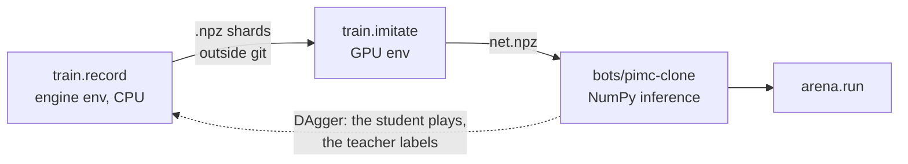
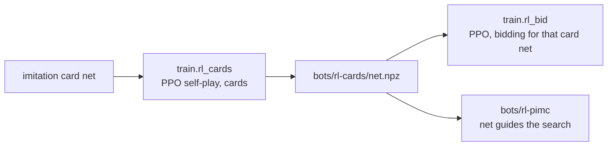

# train/

Imitation learning (rung 2) and self-play RL (rung 3). Recording and rating use the engine's environment; training uses
a separate one, because the home server's GTX 1070 needs PyTorch 2.8 and the engine needs 2.14+.



```bash
# GPU environment (once)
uv venv .venv-gpu --python 3.12
uv pip install --python .venv-gpu/bin/python torch==2.8.0 --index-url https://download.pytorch.org/whl/cu126
uv pip install --python .venv-gpu/bin/python numpy tensorboard

# record, train, rate
uv run python -m train.record --teacher pimc:samples=100 --games 800 --workers 4 --out ~/workspace/estimation-data/rung2/pimc100
.venv-gpu/bin/python -m train.imitate --data ~/workspace/estimation-data/rung2/pimc100 --out bots/pimc-clone/net.npz
uv run python -m arena.sweep --bot pimc-clone --vs pimc --sets 200 --seed 1000 --workers 5 --grid net=net.npz
```

## Watch training live

```bash
# on the server, once: TensorBoard on the server's localhost only
nohup .venv-gpu/bin/tensorboard --logdir ~/workspace/estimation-data/tb --host 127.0.0.1 --port 6006 &
# train with --logdir ~/workspace/estimation-data/tb
# on the Mac: tunnel, then open http://localhost:6006
ssh -N -L 6006:127.0.0.1:6006 home-server
```

`val/regret` plots the student against the random and Heuristic baselines on the same games.

## Pictures board

```bash
PYTHONPATH=. uv run python experiments/trace_game.py --rounds 3 --out ~/workspace/estimation-data/rung2/trace.json
.venv-gpu/bin/python experiments/board.py --data ~/workspace/estimation-data/rung2 \
  --trace ~/workspace/estimation-data/rung2/trace.json --tb ~/workspace/estimation-data/tb
```

TensorBoard, Images tab, run `board`: methods, data, results, and a game replay on the step slider.

## Self-play RL (rung 3)

The GPU environment also needs the engine, installed without its PyTorch pin (same commit as
`uv.lock`):

```bash
rev=$(.venv/bin/python -c "import json,importlib.metadata as m; print(json.loads(m.distribution('estimation-engine').read_text('direct_url.json'))['vcs_info']['commit_id'])")
uv pip install --python .venv-gpu/bin/python --no-deps "estimation-engine @ git+ssh://git@github.com/YosifElessawi/estimation-engine@$rev"
```



```bash
.venv-gpu/bin/python -m train.rl_cards --out cards.npz --iterations 300 --logdir ~/workspace/estimation-data/tb
.venv-gpu/bin/python -m train.rl_bid --cardnet cards.npz --out bid.npz --logdir ~/workspace/estimation-data/tb
```

One process plays rounds in lockstep and batches every net call on the GPU; Python game
stepping is the limit (~100-190 rounds/s on one core).
